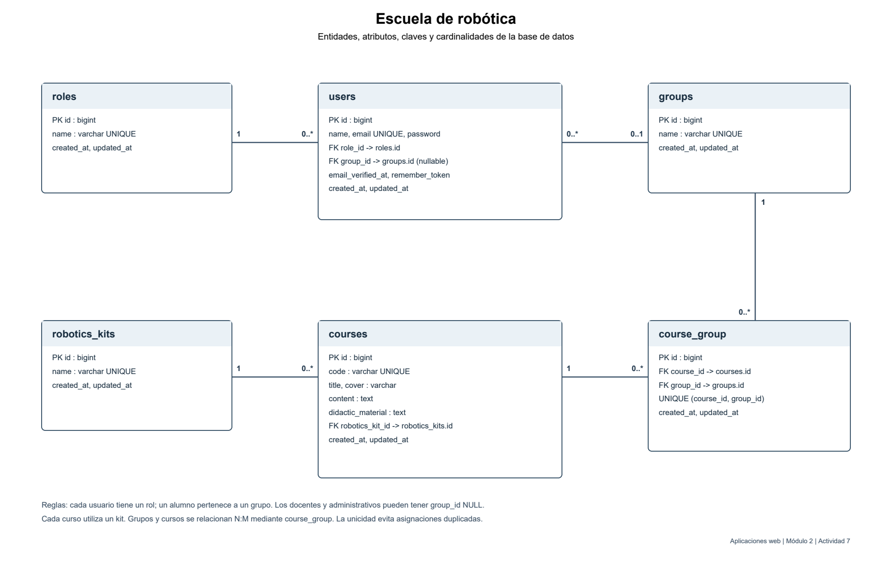

# activity7

Plataforma académica para una escuela de robótica. Los usuarios tienen un rol; los alumnos pertenecen a un grupo, los grupos consultan varios cursos y cada curso utiliza un kit.

## Diagrama ER



## Entorno

Laravel 7.30.7, PHP 7.4 y SQLite con claves foráneas. Uso académico local.

## Instalación

```powershell
composer install
Copy-Item .env.example .env
New-Item database/database.sqlite -ItemType File
php artisan key:generate
php artisan migrate --seed
php artisan serve
```

Configurar `DB_CONNECTION=sqlite` y la ruta absoluta al archivo en `DB_DATABASE` dentro de `.env`. No publicar `.env`.

Los seeders crean tres usuarios de prueba, tres roles, tres grupos y tres kits distintos. Se conservan los cuatro cursos del caso y se agregan 100 cursos con FakerPHP. Los seeders se pueden repetir sin duplicar los datos base ni aumentar los 100 cursos simulados.

Las relaciones se implementan en User, Role, Group, Course y RoboticsKit. La tabla course_group resuelve la relación muchos a muchos. Las contraseñas de prueba se almacenan como hashes.

## Verificación

`php artisan test` valida conteos, roles, relaciones y repetición de seeders. El SQL de entrega se exporta después de ejecutar migraciones y seeders.
